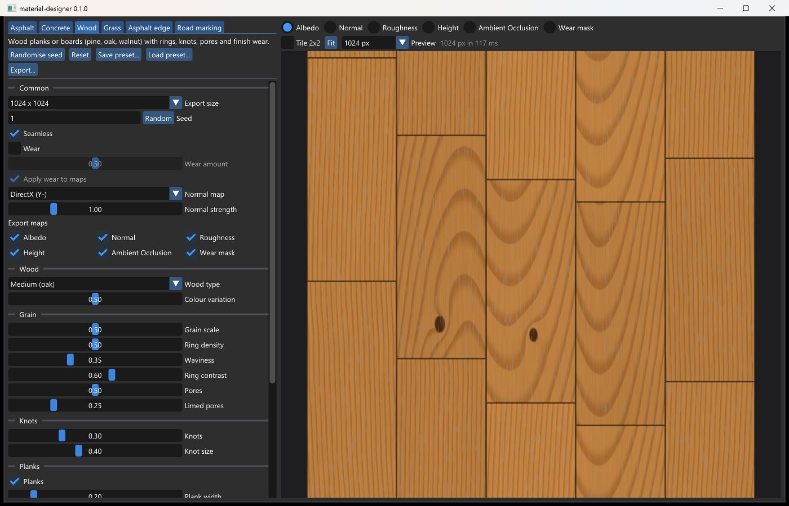
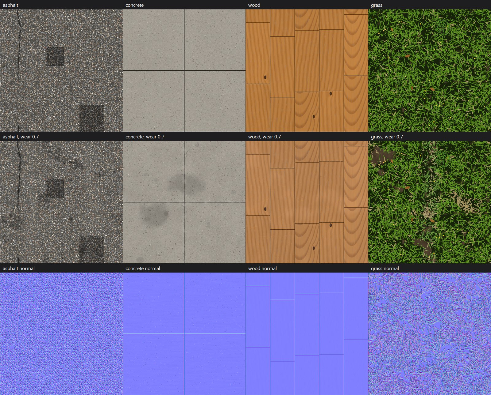
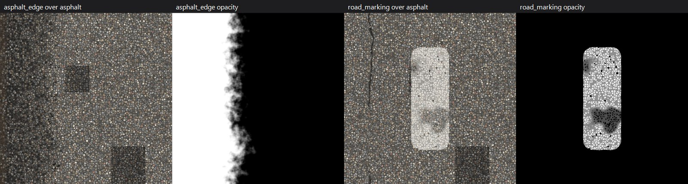

# material-designer

Procedural PBR texture generator for Windows. Generates tileable material textures
(albedo, normal, roughness, height, ambient occlusion and a wear mask) from a small set
of meaningful parameters.

Two front-ends share one generation core:

- **`material-designer.exe`**: interactive GUI (Dear ImGui + DirectX 11) with live preview.
- **`material-designer-cli.exe`**: scriptable, deterministic command-line tool with JSON output.



## Materials

| Id | Kind | Highlights |
|----|------|-----------|
| `asphalt` | base | rounded multicoloured gravel, meandering cracks, repairs; wear: crumbling/alligator cracks, raveling, oil stains, tyre tracks |
| `concrete` | base | broom finish or formwork boards, exposed aggregate, pores, saw-cut joints; wear: chips, water stains, dirt & moss, efflorescence |
| `wood` | base | pine / oak / walnut, flat-sawn irregular rings with cathedral figures, fibrous grain, knots, (limed) pores, stain, staggered planks; wear: scratches, dents, sun fading, worn varnish, weathering |
| `grass` | base | layered blades, clumps, dry blades, clover, flowers, fallen leaves; wear: trampled path, dry patches, bare soil |
| `asphalt_edge` | overlay | crumbling, binder-rich asphalt along a kerb (tiles vertically, with opacity map) |
| `road_marking` | overlay | painted dash or continuous line that follows the surface texture and wears |

Base materials tile seamlessly on both axes. Overlays add an **opacity** map and are blended
over a base material (as a decal or on a separate strip of geometry).





Every material has: resolution (64-8192), seed, seamless toggle, wear toggle + amount, map
selection and DirectX/OpenGL normal maps. Same seed + settings = byte-identical output, in the
GUI and the CLI.

## GUI

One tab per material; every control is generated from the material's parameter schema
(hover for a tooltip, right-click to reset). The preview regenerates automatically on a background
thread (low resolution while dragging a slider) and offers a map selector, a 2x2 tiling check,
zoom (mouse wheel) and pan (drag). Overlays are shown over a checkerboard. Window size and position,
the last export and preset folders and the last settings of every material are remembered in
`%APPDATA%\material-designer\gui-settings.json`.

## Command line

```powershell
material-designer-cli list
material-designer-cli describe concrete
material-designer-cli generate wood --out textures --seed 42 --size 2048 --set wood_type=pine --wear 0.4 --json
```

Writes `<material>_<seed>_<map>.png` (albedo sRGB 8-bit, height 16-bit, other maps 8-bit linear)
plus `<material>_<seed>_settings.json`, a preset that reproduces the textures exactly.
See [CLAUDE.md](CLAUDE.md) for all options and exit codes.

## Building

Requirements: Visual Studio 2026 with the *Desktop development with C++* workload
(MSVC v145 toolset and the bundled *vcpkg package manager*).

```powershell
./build.ps1 -Configuration Release -Test
```

See [CLAUDE.md](CLAUDE.md) for the raw MSBuild commands and an architecture overview.

## License

[MIT](LICENSE)
